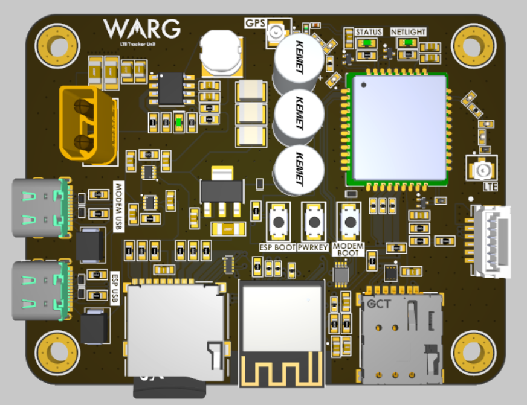

# WARG LTE Tracker

Firmware and local tooling for an ESP32-C3-based tracker PCBA. The board uses
a SIM7080G for cellular connectivity, a separate Holybro M10 receiver for GNSS,
an SD card slot for optional local logging, and a LittleFS-hosted web page for
local diagnostics.

[Firmware Setup Guide](docs/firmware-setup.md)

## Custom PCB

The PCB is shown below. See the [schematic PDF](docs/LTE_Tracker_Schem.pdf)
for the circuit and wiring details.



## Firmware overview

- Samples the external M10 GNSS receiver at 1 Hz using the ESP32-C3 UART.
- Creates a unique session UUID on each power-up.
- Publishes each telemetry sample over MQTT QoS 1 to the public EMQX broker at
  `broker.emqx.io:1883`, on
  `warg/efs-lte-tracker/<session-id>/location`.
- Logs samples to a session-specific CSV on SD when a card is present.
- Serves a local debug interface from LittleFS over the ESP32 access point.
- Runs GNSS sampling separately from cellular and MQTT work.

The EMQX public broker is for testing: traffic is unauthenticated and
unencrypted, and the broker is not a historical data store. QoS 1 acknowledges
receipt by the broker, not by a subscriber or database. The firmware's unsent
queue is in RAM, so samples can be lost on power loss or if the queue fills
during an outage. Use a subscriber to capture and persist messages.

## Build and flash

Install [PlatformIO](https://platformio.org/) and configure the carrier APN in
`include/secrets.h` using `include/secrets.h.example` as a template. Then run:

```text
pio run
pio run -t upload
pio run -t uploadfs
pio device monitor
```

See the [firmware setup guide](docs/firmware-setup.md) for wiring, configuration,
MQTT topic details, and operation notes.

## Local MQTT utilities

The [utils/](utils/) directory contains a Python subscriber that writes live
MQTT messages to CSV and a converter that creates a KML track from that CSV.
Start the subscriber before or while the tracker is publishing; the public
broker does not provide message history.
